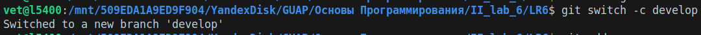
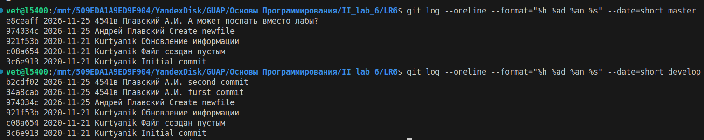
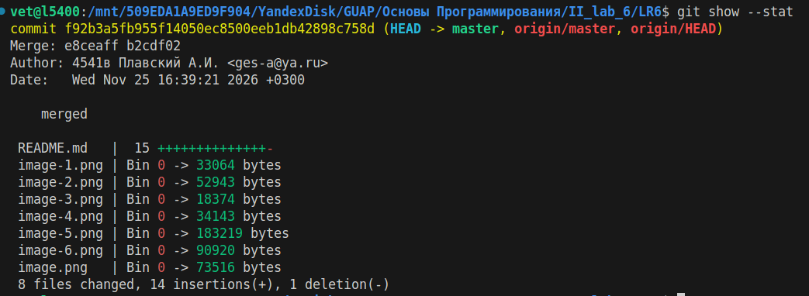
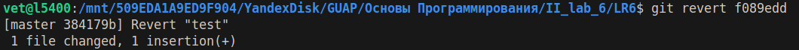
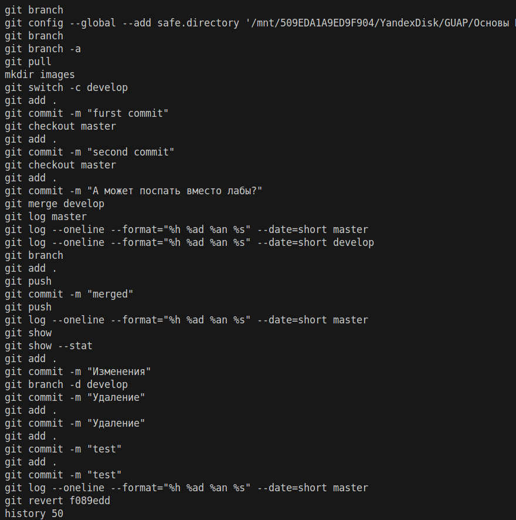
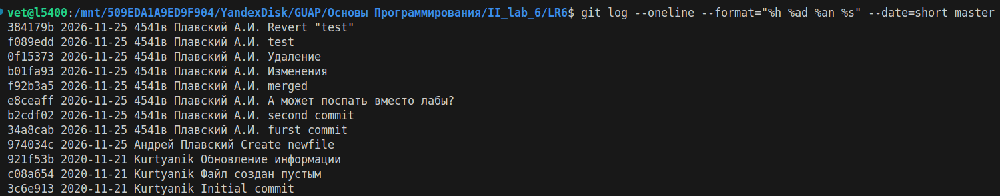

# LR6
Лабораторная работа №6
#### Переименование юзера

#### Клонирование

#### Новый файл

#### Новая ветка

#### Коммит

А может поспать вместо лабы? (accept current)
#### Эдитор

#### Логи

#### Изменения

#### Удаление

#### Отмена коммита

#### История терминала

#### История гита
